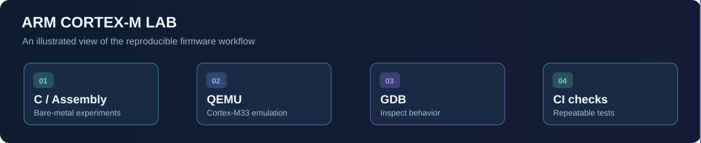
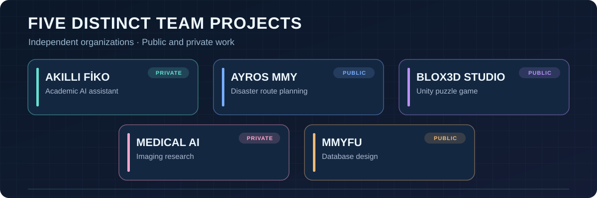
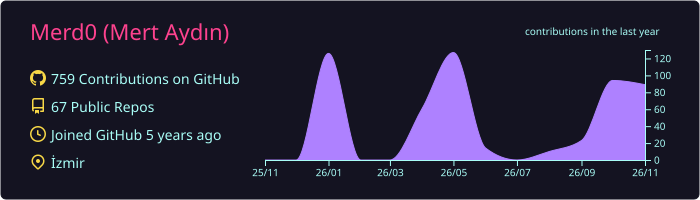
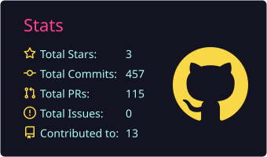
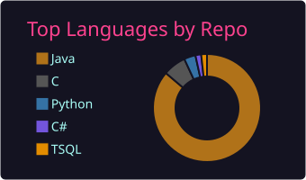

  
  
  

**English** · [Türkçe](README.tr.md)

[Featured Engineering Work](#selected-engineering-work) · [Organization Projects](#team--organization-projects) · [Experience](#industry-experience) · [Toolbox](#technical-toolbox)

---

## Engineering at a Glance

| **Embedded & Low-Level** | **Robotics & Automation** | **Applied AI & Software** |
| :--- | :--- | :--- |
| Arm Cortex-M, C/C++, Assembly, debugging and firmware behavior | Kinematics, industrial robot workflows and interactive 3D learning | Computer vision, data tools, source-grounded AI and application development |

I'm a **Computer Engineering undergraduate at Fırat University, Türkiye**. My work connects low-level systems, robotics, and practical software engineering.

I care about the evidence behind a project: **repeatable builds, observable behavior, automated tests, clear documentation, and honest technical limitations**.

## Selected Engineering Work

A closer look at three **separate projects**, each with its own purpose, engineering approach, and evidence.

### 01 — [ARM Cortex-M Lab](https://github.com/Merd0/ARM-Cortex-M-Lab)
**Embedded firmware · Processor architecture · Reproducible testing**

  
  
  

A practical **Arm Cortex-M33 laboratory** built around bare-metal C and Assembly, exceptions, MPU, SVC, PendSV context switching, and TrustZone. The experiments are compiled, debugged, and checked using **QEMU, GDB, CMake, and CI**. Simulation results are documented separately from physical hardware validation.

  
  Illustrated engineering workflow — not a hardware photograph.

[Explore the lab](https://github.com/Merd0/ARM-Cortex-M-Lab) · [Read the release notes](https://github.com/Merd0/ARM-Cortex-M-Lab/releases/tag/v1.0.0) · [Check CI](https://github.com/Merd0/ARM-Cortex-M-Lab/actions)

---

### 02 — [Robotics Learning Platform](https://github.com/Merd0/robotik-platform)
**Interactive robotics education · Browser-based 3D labs**

  
  
  

An open Turkish-language learning platform connecting robotics theory with experimentation. Its structured lessons cover robot fundamentals, kinematics, motion planning, and industrial applications, supported by interactive 3D environments and validated computational modules.

   
  Actual project screen: Robotics Learning Platform. This image belongs only to the robotics project.

[Launch the live platform](https://robotik-platform.vercel.app/) · [Browse code, architecture and more screenshots](https://github.com/Merd0/robotik-platform)

---

### 03 — [AI Shift Analysis Assistant](https://github.com/Merd0/ai-shift-analysis-assistant)
**Industrial data workflows · Python desktop prototype**

  
  
  

A Python desktop prototype for preparing Excel-based shift logs, identifying potential personal-data fields, filtering records, and generating **AI-assisted operational reports**. Developed as an internship/portfolio prototype; it is not a production-deployed system.

   
  Actual project screen: AI Shift Analysis Assistant. A separate desktop application from the robotics platform above.

[Explore the source, setup and other screens](https://github.com/Merd0/ai-shift-analysis-assistant)

### More Projects & Learning Resources

| Project | Focus |
| --- | --- |
| [C Systems Foundation](https://github.com/Merd0/c-systems-foundation) | **75-step bilingual C/systems learning path** with pointers, memory, modular programs, builds, and tests. |
| [STM32 Survival Guide](https://github.com/Merd0/STM32-Survival-Guide) | Applied STM32F4/HAL-style examples for GPIO, interrupts, timers, and state machines; educational, not hardware-validated product firmware. |
| [Car Vision Project](https://github.com/Merd0/car-vision-project) | Vehicle-recognition application connecting PyTorch ResNet50, FastAPI, a web UI, and Docker. |
| [LeetCode C Solutions](https://github.com/Merd0/leetcode-c-solutions) | <!-- leetcode-c-count:start -->261<!-- leetcode-c-count:end --> documented C solutions, bilingual notes, and algorithm practice tracks. |
| [C++ Learning Lab](https://github.com/Merd0/cpp-learning-lab) | C++17, OOP, STL, CMake, tests, and bilingual learning notes. |

## Team & Organization Projects

My collaborative work spans **five distinct GitHub organizations**. Each entry below is a separate project. Public repositories link to code; private work is presented through non-sensitive, project-level summaries.

| Organization / project | Engineering scope |
| --- | --- |
| **[Akıllı Fiko](https://github.com/akilli-fiko)** · Academic AI Assistant *Private repository* | Independent, source-grounded academic assistance for Fırat University students: Turkish query handling, retrieval and source validation, Node.js/Python services, testing, and development workflows. **Not an official university or OBS service.** |
| **[AYROS MMY](https://github.com/AYROS-MMY/afet-yardim-rota-planlama)** · Disaster-Aid Route Planning *Public repository* | Python graph modeling and **Dijkstra/A*** routing for simulated disaster areas, including damaged or closed roads, destination needs prioritization, and SVG route visualization. A research/educational prototype, not an emergency deployment system. |
| **[BLOX3D Studio](https://github.com/BLOX3D-Studio/BLOX3D)** · 3D Puzzle Game *Public repository* | Unity/URP puzzle game with **60 playable levels**, deterministic grid-based movement, bridges, teleporters, hints, saves, bilingual UI, and level validation tools. |
| **[Cervical Spondylosis Classification](https://github.com/MMY-servikal-spondiloz-siniflama)** · Medical Imaging Research *Private repository* | Research on postoperative neck-pain risk classification from multimodal MRI/CT using deep learning, with training/evaluation pipelines and API/demo tooling. **Not a clinical diagnostic device.** |
| **[MMYFU / Film & TV Archive](https://github.com/MMYFU/Film-Dizi-Arsivi)** · Requirements & Database Design *Public repository* | Functional requirements and relational data modeling for titles, users, reviews, favorites, watchlists, and media relationships. A design/specification project; implementation is not claimed. |

## Industry Experience

| Organization | Experience |
| --- | --- |
| **ASELSAN · 2026** Process Design & Robotic Automation | Worked on robotic automation and laser-based measurement workflows: tool and coordinate systems, motion-related considerations, experimental verification, and technical documentation. |
| **Batıçim · 2025** Information Systems | Worked with enterprise IT and data workflows; created a Python prototype for analyzing production shift records with attention to data minimization. |

## Technical Toolbox

  
  
  
  
  
  
  
  

| Focus | Tools and concepts |
| --- | --- |
| **Embedded / systems** | C/C++, Arm Cortex-M / Armv8-M, Thumb Assembly, MPU, interrupts, QEMU, GDB, STM32 fundamentals |
| **Robotics / automation** | Robot coordinate systems, kinematics, industrial workflows, measurement and verification |
| **Software / AI** | Python, PyTorch, FastAPI, TypeScript, Next.js, C#, SQL, computer vision and data processing |
| **Engineering practices** | Git, CMake, Ninja, Make, Docker, CI, debugging, automated tests and technical documentation |

## How I Work

> **Understand the mechanism → Build a reproducible experiment → Test expected and failure cases → Document evidence and limitations.**

My [ARM Cortex-M Lab](https://github.com/Merd0/ARM-Cortex-M-Lab) is a good example: processor behavior is observed through QEMU/GDB and checked by CI, with a clear distinction between simulated results and real-hardware or real-time guarantees.

## GitHub Activity

  

<strong>More GitHub statistics</strong>

  
  

## Let's Connect

Interested in **embedded software, robotics, or engineering projects**? [Connect with me on LinkedIn](https://linkedin.com/in/mert-ayd%C4%B1n-0578a420b/).

Also available in [Türkçe](README.tr.md).
