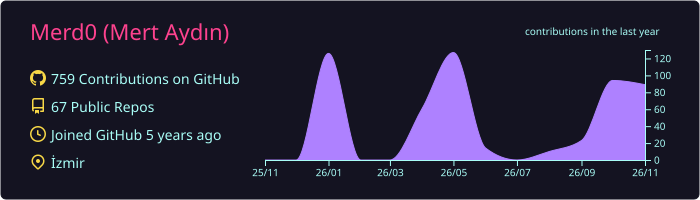
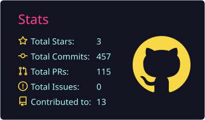
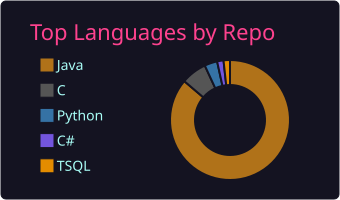

# Mert Aydın

**Bilgisayar Mühendisliği Öğrencisi · Yazılım Geliştirici**

**Gömülü Sistemler • Robotik ve Endüstriyel Otomasyon • Uygulamalı Yapay Zekâ**

*Cortex-M firmware deneylerinden etkileşimli robotiğe ve veri odaklı araçlara kadar, anlaşılabilir, test edilebilir ve tekrar üretilebilir yazılımlar geliştiriyorum.*

  
  
  

[English](README.md) · **Türkçe**

[Projeler](#öne-çıkan-mühendislik-çalışmalarım) · [Ekip Çalışmaları](#organizasyon-ve-ekip-projeleri) · [Deneyim](#endüstriyel-deneyim) · [Yetkinlikler](#teknik-yetkinlikler)

---

## Mühendislik Odağım

| **Gömülü ve Düşük Seviyeli** | **Robotik ve Otomasyon** | **Uygulamalı AI ve Yazılım** |
| :--- | :--- | :--- |
| Arm Cortex-M, C/C++, Assembly, hata ayıklama ve firmware davranışı | Kinematik, endüstriyel robot süreçleri ve etkileşimli 3B eğitim | Bilgisayarlı görü, veri araçları, kaynak temelli AI ve uygulama geliştirme |

**Fırat Üniversitesi Bilgisayar Mühendisliği** öğrencisiyim. Düşük seviyeli sistemler, robotik ve uygulamalı yazılım mühendisliği arasında çalışmalar yürütüyorum.

Bir projenin ardındaki kanıta önem veriyorum: **tekrar üretilebilir derlemeler, gözlemlenebilir davranışlar, otomatik testler, açık dokümantasyon ve teknik sınırların dürüstçe belirtilmesi**.

## Öne Çıkan Mühendislik Çalışmalarım

### 01 / [ARM Cortex-M Lab](https://github.com/Merd0/ARM-Cortex-M-Lab) — Firmware, Hata Ayıklama ve Mimari

**16 uygulamalı ders · 5 birleştirici proje · Secure/Non-secure sensor node**

Bare-metal C/Assembly, exception handling, MPU, SVC, PendSV context switching ve TrustZone konularını ele alan uygulamalı Cortex-M33 laboratuvarı. Deneyler **QEMU, GDB, CMake ve CI** ile derlenip inceleniyor; simülasyon sonuçları fiziksel donanım doğrulaması gibi sunulmuyor.

[Laboratuvarı incele](https://github.com/Merd0/ARM-Cortex-M-Lab) · [v1.0.0 sürümü](https://github.com/Merd0/ARM-Cortex-M-Lab/releases/tag/v1.0.0) · [CI sonuçları](https://github.com/Merd0/ARM-Cortex-M-Lab/actions)

### 02 / [Robotik Öğrenme Platformu](https://github.com/Merd0/robotik-platform) — Etkileşimli Robotik Eğitimi

**94 ders · Etkileşimli 3B laboratuvarlar · Depoda belgelenen 1.056 otomatik test**

Robotik temelleri, kinematik, hareket planlama ve endüstriyel konuları kapsayan açık ve Türkçe eğitim platformu. Tarayıcıda çalıştırılabilen deneyleri yapılandırılmış öğrenme yolları ve hesaplama modüllerinin doğrulanmasıyla birleştiriyor.

[Canlı platformu dene](https://robotik-platform.vercel.app/) · [Kaynak kod ve mimari](https://github.com/Merd0/robotik-platform)

### 03 / [AI Vardiya Analiz Asistanı](https://github.com/Merd0/ai-shift-analysis-assistant) — Endüstriyel Veri ve Uygulamalı AI

Excel tabanlı vardiya kayıtlarını hazırlama, olası kişisel veri alanlarını belirleme, kayıtları filtreleme ve AI destekli operasyon raporları oluşturma için geliştirdiğim **Python masaüstü prototipi**. Üretim ortamına dağıtılmış bir sistem değil, staj/portfolyo çalışmasıdır.

[Kaynak kodu, görselleri ve kurulumu incele](https://github.com/Merd0/ai-shift-analysis-assistant)

  
  

Gerçek proje ekranları — solda robotik öğrenme platformu, sağda AI destekli vardiya analiz arayüzü.

### Diğer Projeler ve Öğrenme Kaynakları

| Proje | Odak |
| --- | --- |
| [C Systems Foundation](https://github.com/Merd0/c-systems-foundation) | Pointer, bellek, modüler programlar, derleme ve testleri içeren **75 adımlı iki dilli C/sistem programlama yolu**. |
| [STM32 Survival Guide](https://github.com/Merd0/STM32-Survival-Guide) | GPIO, kesmeler, zamanlayıcılar ve durum makineleri için STM32F4/HAL tarzı eğitsel örnekler; donanımda doğrulanmış ürün firmware'i değildir. |
| [Car Vision Project](https://github.com/Merd0/car-vision-project) | PyTorch ResNet50, FastAPI, web arayüzü ve Docker'ı birleştiren araç tanıma uygulaması. |
| [LeetCode C Solutions](https://github.com/Merd0/leetcode-c-solutions) | Açıklamalı C çözümleri, iki dilli notlar ve algoritma çalışma yolları. |
| [C++ Learning Lab](https://github.com/Merd0/cpp-learning-lab) | C++17, OOP, STL, CMake, testler ve iki dilli çalışma notları. |

## Organizasyon ve Ekip Projeleri

Bazı ortak çalışmalarımız **özel GitHub organizasyon depolarında** geliştiriliyor. Burada kaynak kodu, iç belgeleri veya veri kümelerini paylaşmadan projelerin mühendislik kapsamını özetliyorum.

| Organizasyon / proje | Herkese açık proje özeti |
| --- | --- |
| **[Akıllı Fiko](https://github.com/akilli-fiko)** · Akademik Yapay Zekâ Asistanı | Fırat Üniversitesi öğrencileri için bağımsız, kaynak temelli akademik bilgi asistanı. Türkçe sorgu işleme, bilgi erişimi/kaynak doğrulama, Node.js/Python servisleri, testler ve geliştirme iş akışları üzerinde çalışıyoruz. **Resmî üniversite ürünü veya OBS entegrasyonu değildir.** |
| **[BLOX3D Studio](https://github.com/BLOX3D-Studio)** · 3B Bulmaca Oyunu | Unity tabanlı bulmaca oyunu geliştirme, etkileşimli mekanikler ve bölüm tasarımı. |
| **[Servikal Spondiloz Sınıflandırma](https://github.com/MMY-servikal-spondiloz-siniflama)** · Tıbbi Görüntüleme Araştırması | Görüntü tabanlı sınıflandırma için bilgisayarlı görü ve derin öğrenme araştırması. **Klinik tanı aracı değil, yazılım araştırmasıdır.** |

**Diğer organizasyonlar:** [AYROS-MMY](https://github.com/AYROS-MMY) · [MMYFU](https://github.com/MMYFU). Bu çalışmaların ayrıntıları henüz burada kamuya açık olarak özetlenmedi.

## Endüstriyel Deneyim

| Kurum | Deneyim |
| --- | --- |
| **ASELSAN · 2026** Süreç Tasarım ve Robotik Otomasyon | Robotik otomasyon ve lazer tabanlı ölçüm çalışmalarında; tool ve koordinat sistemleri, hareket değerlendirmeleri, deneysel doğrulama ve teknik dokümantasyon üzerinde çalıştım. |
| **Batıçim · 2025** Bilgi Sistemleri | Kurumsal BT ve veri süreçleriyle çalıştım; veri minimizasyonunu dikkate alarak üretim vardiya kayıtlarının analizi için Python prototipi geliştirdim. |

## Teknik Yetkinlikler

  
  
  
  
  
  
  
  

| Çalışma alanı | Araçlar ve kavramlar |
| --- | --- |
| **Gömülü / sistemler** | C/C++, Arm Cortex-M / Armv8-M, Thumb Assembly, MPU, kesmeler, QEMU, GDB, STM32 temelleri |
| **Robotik / otomasyon** | Robot koordinat sistemleri, kinematik, endüstriyel süreçler, ölçüm ve doğrulama |
| **Yazılım / AI** | Python, PyTorch, FastAPI, TypeScript, Next.js, C#, SQL, bilgisayarlı görü ve veri işleme |
| **Mühendislik pratiği** | Git, CMake, Ninja, Make, Docker, CI, hata ayıklama, otomatik testler ve teknik dokümantasyon |

## Çalışma Yaklaşımım

> **Mekanizmayı anla → Tekrar üretilebilir deney kur → Beklenen ve hatalı durumları test et → Kanıtları ve sınırları belgele.**

[ARM Cortex-M Lab](https://github.com/Merd0/ARM-Cortex-M-Lab) bu yaklaşımın bir örneği: işlemci davranışları QEMU/GDB üzerinden gözlemleniyor ve CI ile kontrol ediliyor; simülasyon sonuçları gerçek donanım veya gerçek zamanlı çalışma garantileriyle karıştırılmıyor.

## GitHub Aktivitesi

  

<strong>Diğer GitHub istatistikleri</strong>

  
  

## İletişim

**Gömülü yazılım, robotik veya mühendislik projeleri** için [LinkedIn üzerinden iletişime geçebilirsin](https://linkedin.com/in/mert-ayd%C4%B1n-0578a420b/).

Read this profile in [English](README.md).
