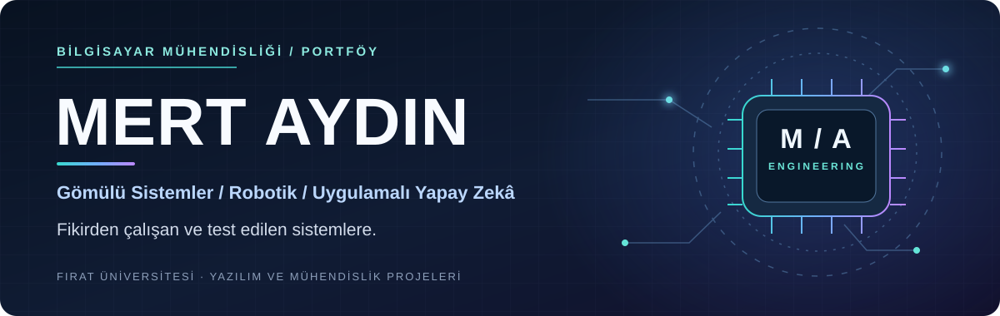
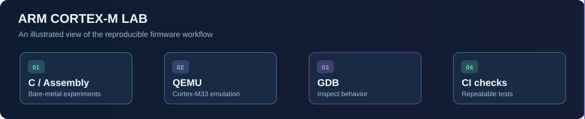
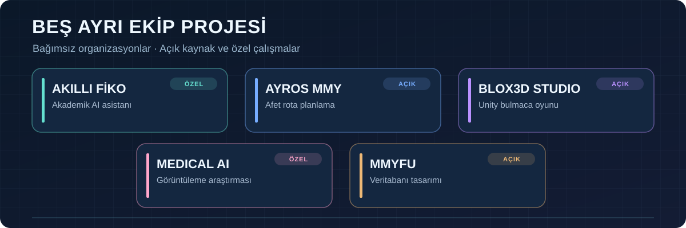

  
  
  

[English](README.md) · **Türkçe**

[Öne Çıkan Projeler](#öne-çıkan-mühendislik-çalışmalarım) · [Organizasyonlar](#organizasyon-ve-ekip-projeleri) · [Deneyim](#endüstriyel-deneyim) · [Yetkinlikler](#teknik-yetkinlikler)

---

## Mühendislik Odağım

| **Gömülü ve Düşük Seviyeli** | **Robotik ve Otomasyon** | **Uygulamalı AI ve Yazılım** |
| :--- | :--- | :--- |
| Arm Cortex-M, C/C++, Assembly, hata ayıklama ve firmware davranışı | Kinematik, endüstriyel robot süreçleri ve etkileşimli 3B eğitim | Bilgisayarlı görü, veri araçları, kaynak temelli AI ve uygulama geliştirme |

**Fırat Üniversitesi Bilgisayar Mühendisliği** öğrencisiyim. Düşük seviyeli sistemler, robotik ve uygulamalı yazılım mühendisliği arasında çalışmalar yürütüyorum.

Bir projenin ardındaki kanıta önem veriyorum: **tekrar üretilebilir derlemeler, gözlemlenebilir davranışlar, otomatik testler, açık dokümantasyon ve teknik sınırların dürüstçe belirtilmesi**.

## Öne Çıkan Mühendislik Çalışmalarım

Farklı problemleri çözen **üç bağımsız projeyi**, gerçek çıktıları ve mühendislik yaklaşımlarıyla birlikte tanıtıyorum.

### 01 — [ARM Cortex-M Lab](https://github.com/Merd0/ARM-Cortex-M-Lab)
**Gömülü yazılım · İşlemci mimarisi · Tekrarlanabilir testler**

  
  
  

Bare-metal C/Assembly, kesmeler ve istisnalar, MPU, SVC, PendSV bağlam değiştirme ve TrustZone konularını ele alan uygulamalı **Arm Cortex-M33 laboratuvarı**. Deneyler **QEMU, GDB, CMake ve CI** ile derleniyor, gözlemleniyor ve test ediliyor. Simülasyon bulguları fiziksel donanım doğrulaması gibi sunulmuyor.

   
  Geliştirme sürecini gösteren özgün çizim; donanım fotoğrafı değildir.

[Laboratuvarı incele](https://github.com/Merd0/ARM-Cortex-M-Lab) · [Sürüm notlarını oku](https://github.com/Merd0/ARM-Cortex-M-Lab/releases/tag/v1.0.0) · [CI sonuçlarına bak](https://github.com/Merd0/ARM-Cortex-M-Lab/actions)

---

### 02 — [Robotik Öğrenme Platformu](https://github.com/Merd0/robotik-platform)
**Etkileşimli robotik eğitimi · Tarayıcıda çalışan 3B laboratuvarlar**

  
  
  

Robotik teorisini uygulamalı deneylerle buluşturan açık ve Türkçe bir eğitim platformu. Robotik temelleri, kinematik, hareket planlama ve endüstriyel uygulamalara yönelik yapılandırılmış dersler; etkileşimli 3B ortamlar ve doğrulanan hesaplama modülleriyle destekleniyor.

   
  Gerçek proje ekranı: Robotik Öğrenme Platformu. Görsel yalnızca bu projeye aittir.

[Canlı platformu aç](https://robotik-platform.vercel.app/) · [Kod, mimari ve diğer ekranları incele](https://github.com/Merd0/robotik-platform)

---

### 03 — [AI Vardiya Analiz Asistanı](https://github.com/Merd0/ai-shift-analysis-assistant)
**Endüstriyel veri süreçleri · Python masaüstü prototipi**

  
  
  

Excel tabanlı vardiya kayıtlarını hazırlama, olası kişisel veri alanlarını belirleme, kayıtları filtreleme ve **yapay zekâ destekli operasyon raporları** üretme amacıyla geliştirdiğim Python masaüstü prototipi. Staj/portfolyo çalışmasıdır; üretim ortamına dağıtılmış bir sistem değildir.

   
  Gerçek proje ekranı: AI Vardiya Analiz Asistanı. Yukarıdaki robotik platformundan ayrı bir uygulamadır.

[Kaynak kodu, kurulumu ve diğer ekranları incele](https://github.com/Merd0/ai-shift-analysis-assistant)

### Diğer Projeler ve Öğrenme Kaynakları

| Proje | Odak |
| --- | --- |
| [C Systems Foundation](https://github.com/Merd0/c-systems-foundation) | Pointer, bellek, modüler programlar, derleme ve testleri içeren **75 adımlı iki dilli C/sistem programlama yolu**. |
| [STM32 Survival Guide](https://github.com/Merd0/STM32-Survival-Guide) | GPIO, kesmeler, zamanlayıcılar ve durum makineleri için STM32F4/HAL tarzı eğitsel örnekler; donanımda doğrulanmış ürün firmware'i değildir. |
| [Car Vision Project](https://github.com/Merd0/car-vision-project) | PyTorch ResNet50, FastAPI, web arayüzü ve Docker'ı birleştiren araç tanıma uygulaması. |
| [LeetCode C Solutions](https://github.com/Merd0/leetcode-c-solutions) | Açıklamalı C çözümleri, iki dilli notlar ve algoritma çalışma yolları. |
| [C++ Learning Lab](https://github.com/Merd0/cpp-learning-lab) | C++17, OOP, STL, CMake, testler ve iki dilli çalışma notları. |

## Organizasyon ve Ekip Projeleri

Çalışmalarım **beş ayrı GitHub organizasyonu** arasında yer alıyor. Aşağıdaki her giriş bağımsız bir projedir. Açık depoların kodlarına bağlantı veriyorum; özel projeleri ise hassas bilgi paylaşmadan tanıtıyorum.

| Organizasyon / proje | Mühendislik kapsamı |
| --- | --- |
| **[Akıllı Fiko](https://github.com/akilli-fiko)** · Akademik Yapay Zekâ Asistanı *Özel depo* | Fırat Üniversitesi öğrencileri için bağımsız, kaynak temelli akademik bilgi asistanı: Türkçe sorgu işleme, bilgi erişimi ve kaynak doğrulama, Node.js/Python servisleri, testler ve geliştirme iş akışları. **Resmî üniversite ürünü veya OBS entegrasyonu değildir.** |
| **[AYROS MMY](https://github.com/AYROS-MMY/afet-yardim-rota-planlama)** · Afet Yardım Rota Planlama *Herkese açık depo* | Simüle edilmiş afet bölgeleri için Python çizge modelleme, **Dijkstra/A*** ile rota hesabı, hasarlı/kapalı yollar, ihtiyaç önceliklendirme ve SVG rota görselleştirmesi. Gerçek afet müdahale sistemi değil, akademik prototiptir. |
| **[BLOX3D Studio](https://github.com/BLOX3D-Studio/BLOX3D)** · 3B Bulmaca Oyunu *Herkese açık depo* | Unity/URP ile **60 oynanabilir seviyeli** oyun; deterministik grid hareketi, köprüler, ışınlayıcılar, ipuçları, kayıt, iki dilli arayüz ve bölüm doğrulama araçları. |
| **[Servikal Spondiloz Sınıflandırma](https://github.com/MMY-servikal-spondiloz-siniflama)** · Tıbbi Görüntüleme Araştırması *Özel depo* | Çok modlu MRI/CT verilerinden ameliyat sonrası boyun ağrısı riski sınıflandırması üzerine derin öğrenme araştırması; eğitim/değerlendirme süreçleri ve API/demo araçları. **Klinik tanı cihazı değildir.** |
| **[MMYFU / Film-Dizi Arşivi](https://github.com/MMYFU/Film-Dizi-Arsivi)** · Gereksinim ve Veritabanı Tasarımı *Herkese açık depo* | Film/dizi, kullanıcı, yorum, favori, izleme listesi ve ilişkiler için işlevsel gereksinim analizi ve ilişkisel veri modeli. Tamamlanmış uygulama değil, tasarım/şartname çalışmasıdır. |

## Endüstriyel Deneyim

| Kurum | Deneyim |
| --- | --- |
| **ASELSAN · 2026** Süreç Tasarım ve Robotik Otomasyon | Robotik otomasyon ve lazer tabanlı ölçüm çalışmalarında; tool ve koordinat sistemleri, hareket değerlendirmeleri, deneysel doğrulama ve teknik dokümantasyon üzerinde çalıştım. |
| **Batıçim · 2025** Bilgi Sistemleri | Kurumsal BT ve veri süreçleriyle çalıştım; veri minimizasyonunu dikkate alarak üretim vardiya kayıtlarının analizi için Python prototipi geliştirdim. |

## Teknik Yetkinlikler

  
  
  
  
  
  
  
  

| Çalışma alanı | Araçlar ve kavramlar |
| --- | --- |
| **Gömülü / sistemler** | C/C++, Arm Cortex-M / Armv8-M, Thumb Assembly, MPU, kesmeler, QEMU, GDB, STM32 temelleri |
| **Robotik / otomasyon** | Robot koordinat sistemleri, kinematik, endüstriyel süreçler, ölçüm ve doğrulama |
| **Yazılım / AI** | Python, PyTorch, FastAPI, TypeScript, Next.js, C#, SQL, bilgisayarlı görü ve veri işleme |
| **Mühendislik pratiği** | Git, CMake, Ninja, Make, Docker, CI, hata ayıklama, otomatik testler ve teknik dokümantasyon |

## Çalışma Yaklaşımım

> **Mekanizmayı anla → Tekrar üretilebilir deney kur → Beklenen ve hatalı durumları test et → Kanıtları ve sınırları belgele.**

[ARM Cortex-M Lab](https://github.com/Merd0/ARM-Cortex-M-Lab) bu yaklaşımın bir örneği: işlemci davranışları QEMU/GDB üzerinden gözlemleniyor ve CI ile kontrol ediliyor; simülasyon sonuçları gerçek donanım veya gerçek zamanlı çalışma garantileriyle karıştırılmıyor.

## GitHub Aktivitesi

  

<strong>Diğer GitHub istatistikleri</strong>

  
  

## İletişim

**Gömülü yazılım, robotik veya mühendislik projeleri** için [LinkedIn üzerinden iletişime geçebilirsin](https://linkedin.com/in/mert-ayd%C4%B1n-0578a420b/).

Read this profile in [English](README.md).
